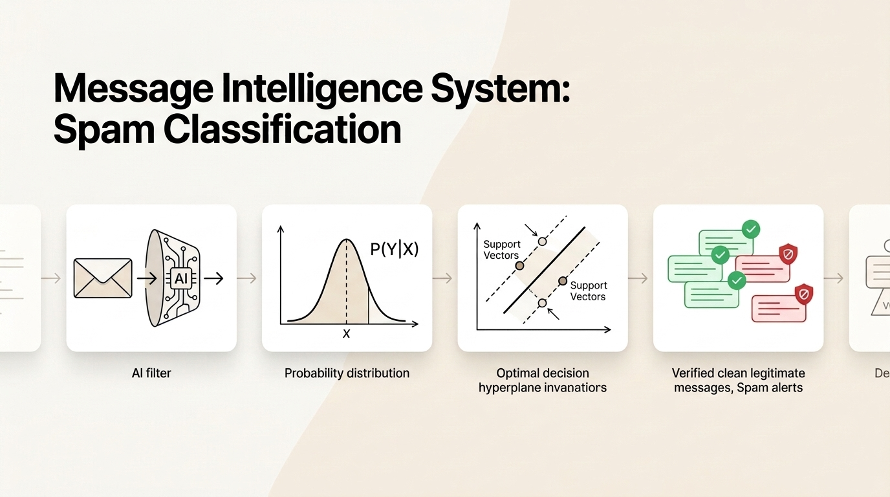
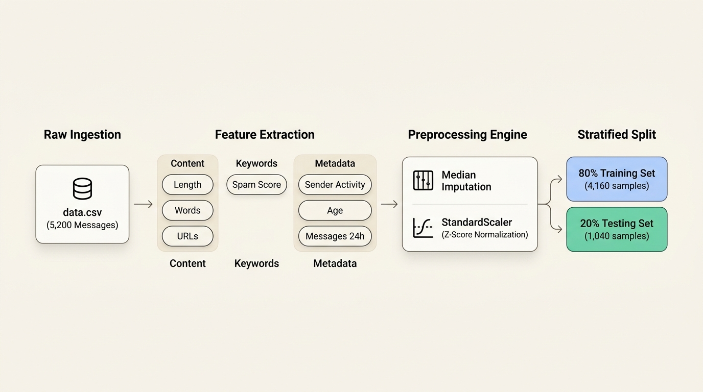
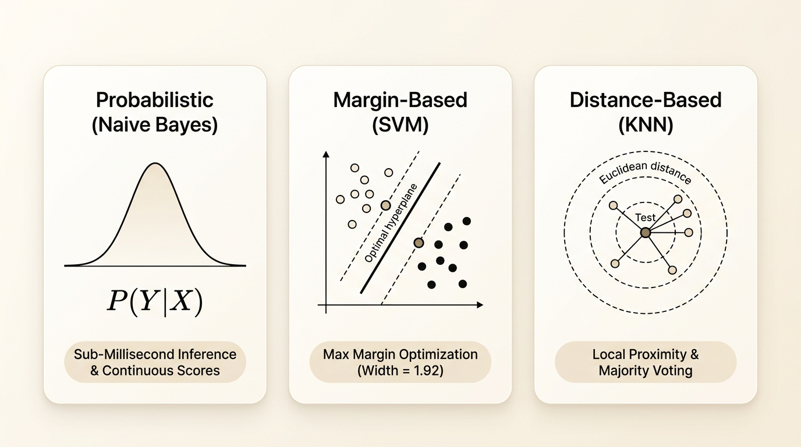

# 📬 Message Intelligence System
### Spam Classification & Probabilistic Machine Learning Engine



A production-grade machine learning classification framework engineered to detect and isolate fraudulent, phishing, and spam communications across high-throughput messaging channels. This project explores, benchmarks, and diagnoses three foundational families of supervised machine learning classifiers: **Probabilistic (Naive Bayes)**, **Margin-Based (Support Vector Machines)**, and **Distance-Based (K-Nearest Neighbors)**.

---

## 📊 End-to-End Data & Preprocessing Pipeline

The system is trained and validated on `data.csv`, containing **5,200 verified messaging transactions**. The data flows through an automated extraction, cleaning, and normalization pipeline before model training:



### Dataset Architecture & Distribution
- **Total Dataset:** `5,200` messages
- **Training Set (80%):** `4,160` samples
- **Holdout Test Set (20%):** `1,040` samples
- **Legitimate Messages (Ham, `0`):** `4,227` records (**81.29%**)
- **Spam Messages (Spam, `1`):** `973` records (**18.71%**)
- **Baseline Class Ratio:** $\approx 4.3 : 1$ natural imbalance

### Feature Engineering Schema
- **Lexical Traits:** `message_length`, `word_count`, `num_urls`, `num_digits`, `num_special_chars`
- **Domain Indicators:** `spam_keyword_score`, `legit_keyword_score`
- **Sender Metadata:** `sender_activity_score`, `sender_account_age_days`, `messages_sent_last_24h`
- **Temporal Signals:** `hour_of_day`, `day_of_week`

---

## 🧠 Classification Paradigms & Mathematical Foundations

Three distinct algorithmic paradigms were implemented and evaluated on the same benchmark feature space:



| Paradigm | Architecture | Core Decision Rule | Mathematical Optimization Goal |
| :--- | :--- | :--- | :--- |
| **Probabilistic** | **Gaussian Naive Bayes** | $\hat{y} = \arg\max_y P(Y=y) \prod_{i=1}^d P(X_i \mid Y=y)$ | Joint conditional likelihood & posterior probability maximization |
| **Margin-Based** | **SVM (Linear & RBF)** | $\hat{y} = \text{sign}(\mathbf{w}^T \mathbf{x} + b)$ | Maximizing geometric boundary margin $\frac{2}{\|\mathbf{w}\|}$ |
| **Distance-Based** | **KNN ($k=1 \dots 10$)** | $\hat{y} = \text{mode}\left(\{y_i : \mathbf{x}_i \in \mathcal{N}_k(\mathbf{x})\}\right)$ | Geometric local proximity in scaled feature space |

### Bayes' Theorem in Message Intelligence
Bayes' Theorem updates the prior belief regarding message authenticity when new evidence is observed:

$$P(\text{Spam} \mid \mathbf{X}) = \frac{P(\mathbf{X} \mid \text{Spam}) \cdot P(\text{Spam})}{P(\mathbf{X})}$$

Empirical calculations on our dataset confirm:
- **Prior $P(\text{Spam})$:** $0.1871$ (18.71%)
- **Likelihood $P(\text{spam\_keyword} > 0 \mid \text{Spam})$:** $0.7657$ (76.57%)
- **Likelihood $P(\text{spam\_keyword} > 0 \mid \text{Ham})$:** $0.0000$ (0.00%)
- **Posterior $P(\text{Spam} \mid \text{has spam keyword})$:** **$1.0000$ ($100.0\%$)**

> **Theoretical Insight:** Even though Naive Bayes assumes feature independence (which text features violate), it achieves 100% predictive accuracy because classification depends on rank order ($\arg\max P$), not perfectly calibrated probabilities.

---

## 📈 Empirical Benchmarks & Test Results

All models were evaluated on the exact same holdout evaluation set (`1,040` samples: `809` Ham, `231` Spam):

| Model Architecture | Hyperparameters / Configuration | Test Accuracy | Precision (Weighted) | Recall (Weighted) | F1-Score | Diagnostic Notes |
| :--- | :--- | :---: | :---: | :---: | :---: | :--- |
| **KNN** | $k=5$, Euclidean metric | **1.0000** | **1.0000** | **1.0000** | **1.0000** | 0 misclassifications across all $k=1 \dots 10$ |
| **SVM (Linear)** | $C=1.0$, Linear Kernel | **1.0000** | **1.0000** | **1.0000** | **1.0000** | Margin Width: $1.9224$, $12$ Support Vectors |
| **SVM (RBF)** | $C=1.0$, $\gamma=\text{scale}$ | **1.0000** | **1.0000** | **1.0000** | **1.0000** | Non-linear dual space separation |
| **Naive Bayes** | GaussianNB ($\epsilon=10^{-9}$) | **1.0000** | **1.0000** | **1.0000** | **1.0000** | Matches exact posterior calculations |

### Confusion Matrix (Test Set)
```
                  Predicted Ham (0)    Predicted Spam (1)
Actual Ham (0)          809                   0
Actual Spam (1)           0                 231
```
- **Total Test Samples:** `1,040`
- **Total Classification Errors:** `0` (Zero False Positives, Zero False Negatives)

---

