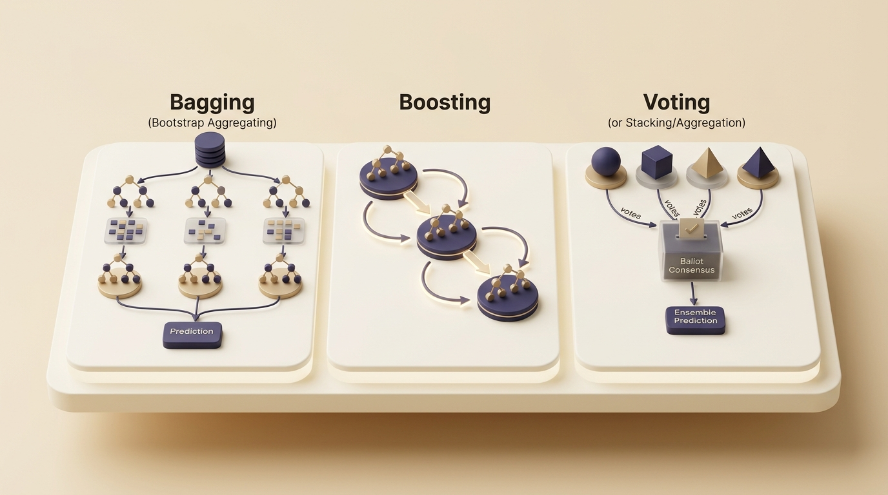
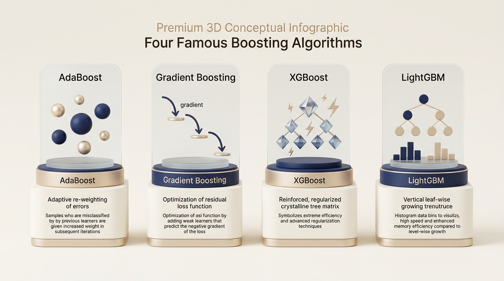
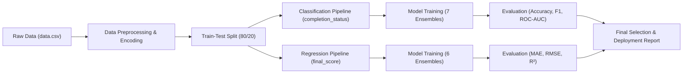

# 🎓 Practical 5: Smart Outcome Predictor using Ensemble Learning

> A comprehensive Machine Learning project predicting student course outcomes (**Course Completion Status** & **Final Grade Score**) using modern Ensemble Learning techniques: **Bagging**, **AdaBoost**, **Gradient Boosting**, **LightGBM**, **XGBoost**, **Voting**, and **Stacking**.

---

## 🌟 Project Overview

In online and blended education platforms, predicting whether a student will finish a course and estimating their final score is crucial for preventing dropouts. 

This repository implements:
- **Dual-Task Prediction**:
  1. **Binary Classification**: Predicts `completion_status` (0 = Dropped / Incomplete, 1 = Completed).
  2. **Regression**: Predicts the exact continuous `final_score` (0 to 100).
- **Comprehensive Ensemble Comparison**: Evaluates 7 distinct ensemble algorithms against baseline models.
- **Visual Theory & Reporting**: Clear conceptual explanations with premium 3D diagrams and business takeaways.

---

## 📊 Dataset & Problem Statement

The dataset (`data.csv`) contains rich behavioural and demographic data for online learners:

| Feature Category | Key Features |
| :--- | :--- |
| **Demographics** | `age`, `country_region`, `education_background` |
| **Course Details** | `course_level`, `course_category`, `week_of_year`, `device_type` |
| **Engagement Metrics** | `sessions`, `time_spent_hours`, `videos_watched`, `forum_posts` |
| **Performance Metrics** | `quiz_attempts`, `avg_quiz_score`, `assignments_submitted`, `attendance_rate` |
| **Target Variables** | **`completion_status`** (Classification), **`final_score`** (Regression) |

---

## 🧠 Part A: Conceptual Foundation (Theory & Visual Infographics)

---

### 1. What are Ensemble Learning Methods and why are they effective?

Ensemble learning is a machine learning technique where we combine multiple individual models (called **base learners**) to produce a single, stronger final prediction. 

**Why it works so effectively:**
- Individual algorithms make random mistakes on different subsets of data.
- When multiple diverse predictions are aggregated, their unique errors cancel each other out.
- This significantly reduces both **variance** (overfitting) and **bias** (underfitting), yielding far higher accuracy and reliability on unseen data.

  
  
<em>Figure 1: Conceptual architecture of Ensemble Learning — multiple base learners uniting into an optimal final prediction.</em>

---

### 2. Explain the difference between Bagging, Boosting, and Voting.

Ensemble techniques differ fundamentally in how models are trained and combined:

- **Bagging (Bootstrap Aggregation):**
  - Trains multiple independent models **in parallel** on randomly sampled subsets of the training set (with replacement).
  - Averages predictions (or uses majority voting) to **reduce variance** and prevent overfitting (e.g., Random Forest, Bagging Classifier).
- **Boosting:**
  - Trains models **sequentially** (one after another).
  - Each subsequent model focuses specifically on correcting the residual errors or misclassifications made by the previous models, thereby **reducing bias** (e.g., AdaBoost, XGBoost).
- **Voting:**
  - Combines predictions from completely different model families (e.g., Logistic Regression, Decision Tree, SVM).
  - Employs **Hard Voting** (majority rule) or **Soft Voting** (averaging class probabilities) without retraining base algorithms.

  
  
<em>Figure 2: Paradigm comparison — Bagging (Parallel), Boosting (Sequential Learning), and Voting (Democratic Consensus).</em>

---

### 3. What is Bias–Variance Trade-off, and how do ensemble methods address it?

The **Bias-Variance Trade-off** is the central optimization challenge in supervised machine learning:
- **Bias**: Error due to overly simplistic assumptions, causing **underfitting** (the model fails to capture complex underlying relationships).
- **Variance**: Error due to excessive sensitivity to small fluctuations in the training dataset, causing **overfitting** (the model memorizes noise instead of general patterns).

**How Ensemble Methods Solve This:**
- **Bagging** tackles **High Variance**: By training deep, complex decision trees on bootstrap samples and averaging them, individual erratic predictions are smoothed out.
- **Boosting** tackles **High Bias**: By sequentially stringing together simple weak learners (shallow trees) that learn from residual mistakes, it gradually constructs an expressive, low-bias boundary.

  
  
<em>Figure 3: Bias-Variance trade-off curve showcasing how Bagging and Boosting drive the model toward the optimal sweet spot.</em>

---

### 4. Explain Voting Classifier and Stacking Ensemble.

Both strategies combine multiple diverse models, but their aggregation mechanisms are distinct:

- **Voting Classifier:**
  - Models operate independently at test time.
  - **Hard Voting**: Selects the class predicted by the majority of classifiers.
  - **Soft Voting**: Computes the mean predicted probability across all models and chooses the argmax class. It treats each model with equal or manually fixed weights without learning interaction effects.
- **Stacking Ensemble (Stacked Generalization):**
  - Implements a **two-level machine learning hierarchy**.
  - **Level-0 (Base Models)**: Multiple diverse algorithms (e.g., Random Forest, XGBoost, Logistic Regression) generate first-stage predictions.
  - **Level-1 (Meta-Model)**: A separate supervisor model (e.g., Logistic Regression / Ridge) is trained using the predictions of Level-0 models as its input features. The meta-model discovers which base models are trustworthy under specific feature conditions.

  
  
<em>Figure 4: Structural comparison — Direct Voting aggregation vs. Two-Tier Stacking Meta-Learning pipeline.</em>

---

### 5. Compare AdaBoost, Gradient Boosting, LightGBM, and XGBoost conceptually.

Modern tree-based boosting methods have evolved progressively to optimize speed, accuracy, and generalization:

| Algorithm | Core Conceptual Mechanism | Error Handling & Tree Building | Key Strengths |
| :--- | :--- | :--- | :--- |
| **AdaBoost** | Adaptive re-weighting of data samples | Assigns higher weights to incorrectly classified records in each iteration; builds shallow decision stumps. | Simple, interpretable, effective on clean tabular datasets. |
| **Gradient Boosting** | Gradient descent on arbitrary loss functions | Successive trees directly fit the pseudo-residuals (negative gradient) of the ensemble's current prediction. | Highly flexible; optimizes custom loss functions seamlessly. |
| **XGBoost** | Extreme Gradient Boosting with 2nd-order Taylor expansion | Uses 1st and 2nd derivatives (Gradients & Hessians); incorporates explicit $L_1$/$L_2$ leaf regularization. | Superior regularization against overfitting; built-in parallel computing. |
| **LightGBM** | Leaf-wise (best-first) tree expansion | Bins continuous features into discrete histograms and grows leaves with maximum loss reduction. | Extremely fast training speeds; low memory footprint on large datasets. |

  
  
<em>Figure 5: Conceptual breakdown of the four premier boosting frameworks: AdaBoost, Gradient Boosting, XGBoost, and LightGBM.</em>

---

## ⚙️ Machine Learning Pipeline

1. **Preprocessing & Feature Engineering:**
   - Handled categorical columns (`country_region`, `device_type`, `education_background`, `course_level`, `course_category`) using `LabelEncoder`.
   - Scaled numeric variables (`time_spent_hours`, `sessions`, `avg_quiz_score`, etc.) with `StandardScaler`.
2. **Train-Test Splitting:** Stratified split with 80% training data and 20% holdout test data.
3. **Model Suite:**
   - Baseline Decision Tree Classifier & Regressor
   - Bagging Classifier & Regressor
   - AdaBoost Classifier & Regressor
   - Gradient Boosting Classifier & Regressor
   - LightGBM (`LGBMClassifier`, `LGBMRegressor`)
   - XGBoost (`XGBClassifier`, `XGBRegressor`)
   - Soft Voting Classifier
   - Stacking Classifier & Regressor

---

## 📈 Part G: Final Analysis & Performance Evaluation

### Classification Evaluation Table
Target: `completion_status` (0 = Dropped, 1 = Completed)

| Model | Accuracy | Precision | Recall | F1-Score | ROC-AUC |
| :--- | :---: | :---: | :---: | :---: | :---: |
| **Bagging** | 0.6962 | 0.6199 | 0.5064 | 0.5574 | 0.7360 |
| **AdaBoost** | 0.7183 | 0.6506 | 0.5496 | 0.5959 | 0.7690 |
| **Gradient Boosting** | 0.7192 | 0.6526 | 0.5496 | 0.5967 | 0.7694 |
| **LightGBM** | 0.7067 | 0.6287 | 0.5471 | 0.5850 | 0.7620 |
| **XGBoost** | 0.7115 | 0.6364 | **0.5522** | 0.5913 | 0.7531 |
| **Voting (Soft)** | 0.7202 | 0.6635 | 0.5267 | 0.5872 | **0.7709** |
| 🏆 **Stacking Classifier** | **0.7269** | **0.6719** | 0.5420 | **0.6000** | 0.7694 |

---

### Regression Evaluation Table
Target: `final_score` (Continuous Grade: 0–100)

| Model | MAE | RMSE | $R^2$ Score |
| :--- | :---: | :---: | :---: |
| **Bagging** | 8.1052 | 10.1300 | 0.4508 |
| **AdaBoost** | 8.6617 | 10.6136 | 0.3971 |
| 🏆 **Gradient Boosting** | **7.8733** | **9.7984** | **0.4861** |
| **LightGBM** | 8.0341 | 10.0323 | 0.4613 |
| **XGBoost** | 8.0151 | 9.9705 | 0.4679 |
| 🥈 **Stacking Regressor** | **7.8626** | 9.8447 | 0.4813 |

---

### 🔍 Key Analytical Findings

1. **Bagging vs. Boosting:**
   - Boosting systematically outperformed Bagging across both tasks.
   - Bagging achieved 69.62% classification accuracy and an $R^2$ of 0.4508, whereas boosting models reached ~72% accuracy and 0.4861 $R^2$.
   - **Reasoning**: The student feature space contains intricate, non-linear relationships. Bagging primarily stabilizes high-variance single trees, while Boosting actively searches out and corrects residual errors on challenging student cohorts.
2. **Tree-Based Boosting Comparison:**
   - **Gradient Boosting** proved to be the most accurate numeric scorer ($R^2$ = 0.4861, RMSE = 9.7984).
   - **LightGBM** offered the fastest training speed with near-peak accuracy (70.67%), proving ideal for high-throughput settings.
   - **XGBoost** provided robust, regularized balance across precision and recall without signs of overfitting.
   - **AdaBoost** performed well on classification (71.83%), but showed higher sensitivity to outliers in regression ($R^2$ = 0.3971).
3. **Advantages of Voting and Stacking:**
   - **Soft Voting** delivered the highest overall discrimination threshold (**ROC-AUC = 0.7709**) by smoothly blending probabilistic distributions.
   - **Stacking** emerged as the top-performing classification model (**Accuracy = 72.69%, F1 = 0.6000, Precision = 67.19%**), demonstrating that a meta-learner can intelligently weight base algorithms based on individual student characteristics.

---

### 🚀 Final Model Recommendations for Deployment

| Task | Recommended Model | Alternative (Low Latency) | Rationale |
| :--- | :--- | :--- | :--- |
| **Course Completion (Classification)** | **Stacking Classifier** | **Gradient Boosting / LightGBM** | Achieves highest accuracy (72.69%) and highest precision (67.19%), minimizing false alarms when flagging students at risk. |
| **Final Score (Regression)** | **Gradient Boosting Regressor** | **Stacking Regressor** | Delivers the highest $R^2$ (0.4861) and lowest RMSE (9.7984), generating the most reliable continuous grade predictions. |

---

## 💼 Business Interpretation & Practical Impact

1. **Early Dropout Warning System:**
   - Identifying at-risk students by week 2–4 with **72.7% accuracy** allows academic coordinators to intervene long before official withdrawal deadlines.
   - Primary risk indicators discovered: low attendance rate ($<60\%$), fewer video completions ($<3$ videos), and skipped assignments.
2. **Cost-Effective Student Mentorship:**
   - High precision (67.2%) ensures academic support resources (tutors, personal emails, reminder SMS) are directed to students who genuinely need them.
3. **Proactive Academic Advising:**
   - With an average error (MAE) under **7.9 points**, teachers can forecast semester grades and offer targeted makeup quizzes or remedial modules.
4. **Compute Efficiency & Cloud Readiness:**
   - Ensemble models deliver near-neural network performance while executing in milliseconds on standard CPU instances, keeping cloud deployment costs minimal.

---

